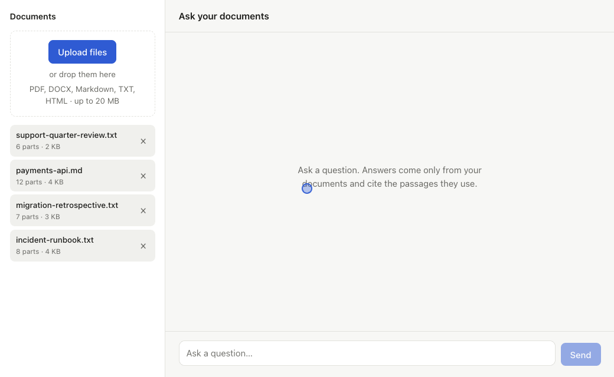
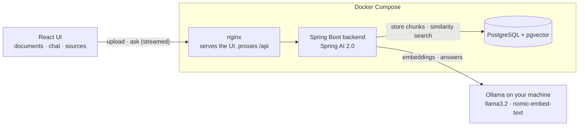
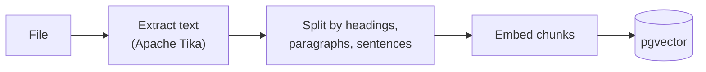
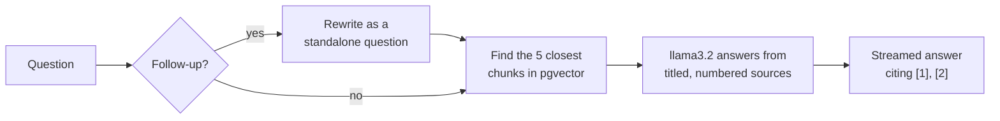

<h1>
  <picture>
    <source media="(prefers-color-scheme: dark)" srcset="https://groundedkit.github.io/brand/docbound-wordmark-dark.png">
    
  </picture>
</h1>

**A production-ready RAG starter for Spring Boot.** Upload your documents and ask questions: answers stream in, cite the exact passages they came from, and say "not found" instead of guessing. Everything runs on your machine with [Ollama](https://ollama.com), so no API keys are needed and documents never leave it.

[](https://github.com/groundedkit/docbound/actions/workflows/ci.yml)
[](LICENSE)



- **Cited, grounded answers:** every claim links to its source passage, and documents are named by title; questions the documents don't cover get "not found" instead of a made-up answer.
- **A real conversation:** follow-up questions understand the last few exchanges, and greetings get a friendly reply instead of an error.
- **Measured retrieval:** structure-aware chunking, tuned with an included evaluation harness ([results](#retrieval-quality)).
- **A complete app:** Spring Boot 4.1 + Spring AI 2.0 backend, React UI, PostgreSQL + pgvector, tests, and a one-command Docker setup.

## Contents

- [Quick start](#quick-start) (macOS, Windows, Linux)
- [Using Docbound](#using-docbound)
- [How it works](#how-it-works)
- [API](#api)
- [Configuration](#configuration)
- [Development](#development)
- [Retrieval quality](#retrieval-quality)
- [Troubleshooting](#troubleshooting)

## Quick start

### What you need

| | Requirement |
|---|---|
| **Docker** | Docker Desktop (macOS, Windows) or Docker Engine with the Compose plugin (Linux) |
| **Ollama** | Installed and running on your machine |
| **Memory** | 8 GB RAM minimum, 16 GB recommended |
| **Disk** | About 5 GB free (Docker images ~1.6 GB, AI models ~2.3 GB, build cache) |

You don't need Java or Node.js to run Docbound: everything builds inside Docker. They're only needed for [development](#development).

### 1. Install Docker

<details open>
<summary><b>macOS</b></summary>

Install [Docker Desktop for Mac](https://docs.docker.com/desktop/setup/install/mac-install/) (Apple Silicon or Intel), open it, and wait until it shows **Engine running**.
</details>

<details>
<summary><b>Windows</b></summary>

Install [Docker Desktop for Windows](https://docs.docker.com/desktop/setup/install/windows-install/). It uses WSL 2; the installer sets it up, and may ask you to restart. Open Docker Desktop and wait until it shows **Engine running**.
</details>

<details>
<summary><b>Linux</b></summary>

Install [Docker Engine](https://docs.docker.com/engine/install/) for your distribution, which includes the Compose plugin, then let your user run Docker without `sudo` ([details](https://docs.docker.com/engine/install/linux-postinstall/)):

```bash
sudo usermod -aG docker $USER   # then log out and back in
docker compose version          # should print v2.x or later
```
</details>

### 2. Install and start Ollama

Ollama runs on your machine rather than in Docker, because Docker on macOS can't use the GPU and native Ollama is many times faster.

<details open>
<summary><b>macOS</b></summary>

Download the app from [ollama.com/download](https://ollama.com/download) and open it; it runs in the menu bar. Or use Homebrew:

```bash
brew install ollama
brew services start ollama
```
</details>

<details>
<summary><b>Windows</b></summary>

Download the installer from [ollama.com/download](https://ollama.com/download) and run it. Ollama starts automatically and runs in the system tray.
</details>

<details>
<summary><b>Linux</b></summary>

Install with the official script, which also sets Ollama up as a system service:

```bash
curl -fsSL https://ollama.com/install.sh | sh
```

By default Ollama only listens on `127.0.0.1`, which containers can't reach. Allow connections from Docker containers:

```bash
sudo systemctl edit ollama
```

Add these two lines in the editor that opens, save, then restart Ollama:

```ini
[Service]
Environment="OLLAMA_HOST=0.0.0.0"
```

```bash
sudo systemctl restart ollama
```

`0.0.0.0` means every network interface. On a machine reachable from other networks, block port 11434 from outside with your firewall, or [run Ollama in Docker](#run-ollama-in-docker-instead) instead.
</details>

Check that Ollama is running. On every system this should print a table, not "could not connect":

```bash
ollama list
```

### 3. Download the models

About 2.3 GB, once. Doing this first shows a progress bar; otherwise the backend downloads them silently on its first start.

```bash
ollama pull llama3.2
ollama pull nomic-embed-text
```

### 4. Get the code and start Docbound

The same commands work in Terminal (macOS, Linux) and PowerShell (Windows):

```bash
git clone https://github.com/groundedkit/docbound.git
cd docbound
docker compose up --build
```

The first build takes a minute or two. When the log shows `Started DocboundApplication`, open **http://localhost:3000**, upload a document, and ask a question.

### Everyday commands

| Task | Command |
|---|---|
| Start in the background | `docker compose up -d` |
| Stop (keeps your documents) | `docker compose down` |
| Update to the latest version | `git pull`, then `docker compose up --build -d` |
| Show the backend log | `docker compose logs -f backend` |
| Delete all documents and start fresh | `docker compose down -v` |

### Run Ollama in Docker instead

For machines without a native Ollama, such as a Linux server, Ollama can run as a container too. It uses the CPU only, so answers are slower:

```bash
docker compose -f docker-compose.yml -f docker-compose.ollama.yml up --build
```

The models are downloaded into the container on first start. Skip step 2 and 3 in this case.

## Using Docbound

- **Documents** (left): upload PDF, Word (DOCX), Markdown, text or HTML files, up to 20 MB each, with the button or by dragging them in. Each file shows how many parts it was split into. A failed upload shows the reason, such as an unsupported file type. Delete a document with ×.
- **Chat**: answers stream in as they're generated, with bullet lists for broad questions. Citations like **1** are buttons, and each finished answer lists the documents and parts it actually used. Follow-ups such as "tell me more about the second one" or "are you sure?" use the last 3 exchanges. A "not found" answer is shown muted, without citations. **New chat** starts a fresh conversation; **Stop** cancels an answer.
- **Source panel** (right side, or a bottom sheet on phones): click a citation to see the exact passage, its file, part number and match score. `Esc` closes it.

Scanned PDFs (images of text) can't be read; run them through OCR first.

## How it works



### Uploading a document



1. **Parse:** Apache Tika extracts the text.
2. **Split:** `StructureAwareTextSplitter` cuts along the document's structure:
   - Each heading (Markdown `#`, or a title-like line in PDF/DOCX text) starts a new chunk, so unrelated sections don't share an embedding.
   - Once a chunk holds 60 tokens, it ends at the next paragraph. Prose without headings therefore becomes roughly one chunk per paragraph, while short paragraphs are merged.
   - Whole sentences are packed up to 400 tokens. A longer passage continues in a new chunk that repeats the heading and the last ~100 tokens, so an answer on a boundary isn't lost.
3. **Embed and store:** each chunk is embedded with `nomic-embed-text` and saved in pgvector, tagged with its document, file name and position.
4. **Track:** a row in the `documents` table records the upload. Steps 3 and 4 run in one transaction, so a failed upload leaves nothing behind.

### Asking a question



1. **Small talk** ("hi", "thanks", "bye") gets an instant, fixed reply that names your documents, without calling the model.
2. **Follow-ups:** with earlier exchanges in the conversation, the model first rewrites the new message as a standalone question (e.g. "are you sure it's the most important one?" → "Is the obligation to report concerns the most important part of the Policy Workplace Concerns document?"), so search finds the right passages. The last 3 exchanges are also given to the model.
3. **Answering:** the model gets the passages tagged with their document title and is told to answer only from them, cite each statement as `[1]`, `[2]`, and refer to documents by title. If the passages are related but don't answer exactly, it says what the documents do say. If nothing relevant was found, it replies "I couldn't find that in" followed by the document titles, and never answers from outside knowledge.

## API

The UI uses a small REST API on port 8080, which you can also call directly. The examples use bash syntax: on Windows, run them in Git Bash (included with Git for Windows) or WSL rather than PowerShell.

```bash
# Upload a file (pdf, md, markdown, txt, docx, html; up to 20 MB)
curl -F "file=@handbook.pdf" http://localhost:8080/api/documents

# List documents
curl http://localhost:8080/api/documents

# Search the chunks directly (useful for checking what the model will see)
curl "http://localhost:8080/api/search?q=vacation+policy&topK=5"

# Delete a document and all its chunks
curl -X DELETE http://localhost:8080/api/documents/<id>

# Ask a question (streams server-sent events)
curl -N http://localhost:8080/api/chat -H "Content-Type: application/json" \
  -d '{"question": "How many vacation days do I get?"}'
```

Errors are returned as [RFC 9457](https://www.rfc-editor.org/rfc/rfc9457) problem JSON: `415` for unsupported file types, `422` for files with no extractable text (e.g. scanned PDFs), `413` for files that are too large, and `404` for unknown IDs.

### Chat stream

`POST /api/chat` takes a question, plus optionally `topK` (1–10) and the earlier exchanges, oldest first (up to 20; the server uses the last `app.chat.history-turns`):

```json
{
  "question": "Are you sure?",
  "history": [{ "question": "What is the policy about?", "answer": "It covers conduct [1]." }]
}
```

It streams these events, each with JSON data:

| Event | Data | Notes |
|---|---|---|
| `sources` | `{"sources": [{"index", "documentId", "filename", "title", "chunkIndex", "score", "text"}]}` | Sent first. The model cites these as `[index]`. `title` is a readable name derived from the filename. |
| `token` | `{"text": "..."}` | Answer text, piece by piece. |
| `done` | `{"citedSources": [1, 3], "notFound": false, "promptTokens", "completionTokens", "durationMs"}` | `citedSources` lists the sources the answer actually used; show only these as citations. `notFound` is true when the answer is a plain "not found". |
| `error` | `{"message": "..."}` | Generation failed part-way. |

```
event:sources
data:{"sources":[{"index":1,"documentId":"…","filename":"handbook.pdf","chunkIndex":4,"score":0.71,"text":"…"}]}

event:token
data:{"text":"You get 27 days of paid vacation"}

event:token
data:{"text":" [1]."}

event:done
data:{"citedSources":[1],"notFound":false,"promptTokens":753,"completionTokens":32,"durationMs":1890}
```

## Configuration

Settings live in [`backend/src/main/resources/application.yml`](backend/src/main/resources/application.yml). Any of them can also be set as an environment variable for the `backend` service in `docker-compose.yml`: uppercase, with dots and dashes as underscores (e.g. `APP_CHAT_TOP_K=8`).

| Setting | Default | What it does |
|---|---|---|
| `spring.ai.ollama.chat.model` | `llama3.2` | Model that writes the answers. Any Ollama chat model works. |
| `spring.ai.ollama.embedding.model` | `nomic-embed-text` | Model that turns text into vectors. See the note below before changing it. |
| `app.chat.top-k` | `5` | How many chunks the model gets as sources |
| `app.chat.similarity-threshold` | `0.45` | Below this similarity, a chunk isn't used as a source |
| `app.chat.history-turns` | `3` | How many earlier exchanges are used to understand follow-up questions (0 turns follow-ups off) |
| `app.ingestion.chunk-size` | `400` | Maximum chunk size in tokens |
| `app.ingestion.chunk-overlap` | `100` | Tokens repeated when a passage continues in the next chunk |
| `app.ingestion.paragraph-break-tokens` | `60` | Once a chunk holds this many tokens, it ends at the next paragraph |
| `spring.servlet.multipart.max-file-size` | `20MB` | Largest upload |
| `OLLAMA_BASE_URL` (compose) | `http://host.docker.internal:11434` | Where the backend finds Ollama |

Chunking settings only affect new uploads; re-upload existing documents to re-chunk them.

**Changing the embedding model** also changes the vector size. Update `spring.ai.vectorstore.pgvector.dimensions` and the `vector(768)` column (in a new Flyway migration), then re-upload your documents.

## Development

To work on the code you need **Java 21+** and **Node.js 24+**, plus Docker for the database and tests.

### Run the backend from your IDE

Start only Postgres, then run `DocboundApplication` from your IDE, or from the `backend` folder:

```bash
docker compose up -d postgres
cd backend
./mvnw spring-boot:run        # Windows: .\mvnw.cmd spring-boot:run
```

### Run the frontend with hot reload

With the backend running on port 8080, start Vite's dev server on http://localhost:5173. It forwards `/api` to the backend:

```bash
cd frontend
npm install
npm run dev
```

In production, the `frontend` container serves the built app with nginx and forwards `/api` to the backend, with response buffering turned off so answers stream through as they're generated.

### Tests

```bash
cd backend
./mvnw test                   # Windows: .\mvnw.cmd test
```

```bash
cd frontend
npm test
```

The backend tests include integration tests against a real pgvector database; they need Docker and are skipped without it. Tests use a deterministic fake embedding model and a fake chat model, so Ollama isn't required. CI runs both suites on every push.

### Project layout

| Path | What's there |
|---|---|
| `backend/src/main/java/.../ingestion` | Upload, text extraction, `StructureAwareTextSplitter`, document storage |
| `backend/src/main/java/.../chat` | Retrieval, prompt, streaming answers with citations |
| `backend/src/main/java/.../search` | Raw similarity search endpoint |
| `backend/src/main/resources/db/migration` | Flyway schema |
| `frontend/src/api.ts` | Typed API client; `streamChat()` yields the chat events |
| `frontend/src/sse.ts` | Server-sent events parser for `fetch` streams (`EventSource` can't send POST) |
| `frontend/src/useChat.ts` | Conversation state and the request lifecycle (send, stop, errors) |
| `frontend/src/components/` | `DocumentPanel`, `ChatPanel`, `AssistantMessage`, `SourcePanel` |

## Retrieval quality

`RetrievalEval` measures how well search finds the right passage. It ingests the documents in `backend/src/test/resources/eval/docs` (a handbook, an API reference, a runbook, and two prose documents without headings) with different splitter settings, asks the 55 questions in `questions.tsv`, and checks whether the returned chunks contain the expected answer. It uses real embeddings, so Ollama must be running:

```bash
cd backend
./mvnw test -Dtest=RetrievalEval -Deval=true
```

Add your own documents and questions to tune chunking for your data. These results chose the current defaults (`nomic-embed-text`; the model gets the top 5 chunks):

| Splitter | Avg chunk (tokens) | Answer in top 1 | Answer in top 5 | Prose answers in top 5 | MRR |
|---|---|---|---|---|---|
| Spring AI `TokenTextSplitter`, 800 | 629 | 75% | 96% | 17/19 | 0.823 |
| Structure-aware 400/100, no paragraph breaks | 148 | 71% | 95% | 16/19 | 0.816 |
| Structure-aware 400/100, paragraph break at 120 tokens | 131 | 75% | 100% | 19/19 | 0.849 |
| **Structure-aware 400/100, paragraph break at 60 tokens (default)** | 102 | **87%** | **100%** | **19/19** | **0.926** |
| Structure-aware 400/100, paragraph break at 40 tokens | 86 | 85% | 98% | 18/19 | 0.908 |

MRR (mean reciprocal rank) scores how high the right chunk ranks, from 0 to 1. With paragraph breaks on, the chunk size (300, 400 or 600) made no difference on this corpus, because almost every paragraph is shorter than the limit.

`RetrievalEval#relevanceScores` compares similarity scores for answerable questions and for the off-topic questions in `offtopic.txt`; it's how the threshold of 0.45 was chosen. 0.45 is the highest value that keeps all 55 answerable questions (the vaguest, "What would they do differently next time?", scores 0.475). Off-topic questions often score as high as real answers (e.g. "What is the company's dress code?" at 0.64), so they're handled by the model's "not found" rule rather than by the threshold.

`nomic-embed-text`'s `search_query:`/`search_document:` prefixes were also tested and didn't improve results, so they aren't used.

## Troubleshooting

**The page says "Can't reach the backend."** Look at the backend's log:

```bash
docker compose logs backend
```

- **`Couldn't connect to Ollama at …`**: Ollama isn't running, or on Linux isn't reachable from containers. Start it ([step 2](#2-install-and-start-ollama)), and on Linux check the `OLLAMA_HOST` setting. The backend retries by itself and the page recovers within a few seconds.
- **No `Started DocboundApplication` line yet**: the backend is still downloading models you haven't pulled. Wait, or stop it and run [step 3](#3-download-the-models) to see progress.
- **`Port 8080 was already in use`** (or 5432, 3000): another program uses that port, often a local PostgreSQL on 5432. Stop it, or change the left-hand number of that port in `docker-compose.yml`, e.g. `"5433:5432"`.

**Linux: Ollama runs but the backend can't connect.** Besides `OLLAMA_HOST`, a firewall such as `ufw` may block containers. Allow Docker's networks to reach port 11434: `sudo ufw allow from 172.16.0.0/12 to any port 11434`.

**Windows: the build fails with `/bin/sh^M` or `mvnw: not found`.** The repository forces Unix line endings for `mvnw`, but if your copy came from a tool that converted them, re-clone with Git, or run `git config core.autocrlf input` and check the file out again.

**Answers are slow.** The first question after a while takes a few extra seconds while Ollama loads the model into memory. If every answer is slow, check that you're using native Ollama rather than the CPU-only container, and that your machine has enough free memory.

**"I couldn't find that in your documents" for something that is in them.** Check what search returns with `curl "localhost:8080/api/search?q=your+question"`. If the right passage isn't there, try rephrasing with words from the document. Documents uploaded before a chunking setting changed keep their old chunks until you upload them again.

## License

[Apache License 2.0](LICENSE). Use it freely in personal and commercial projects.
